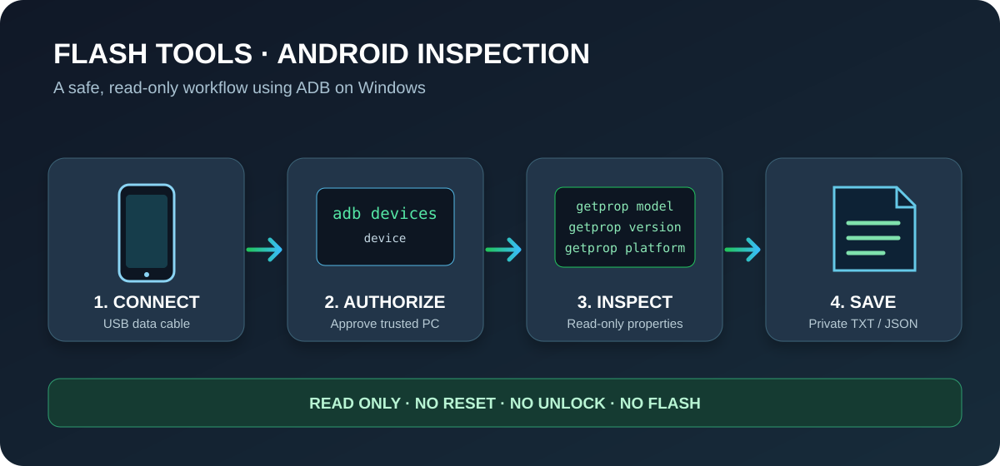
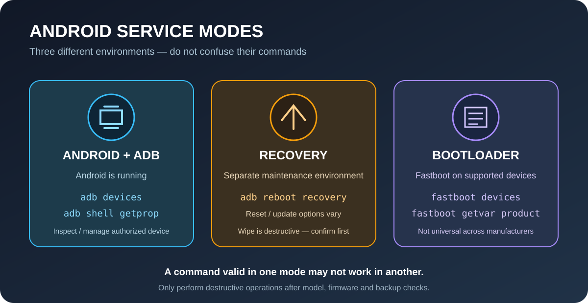
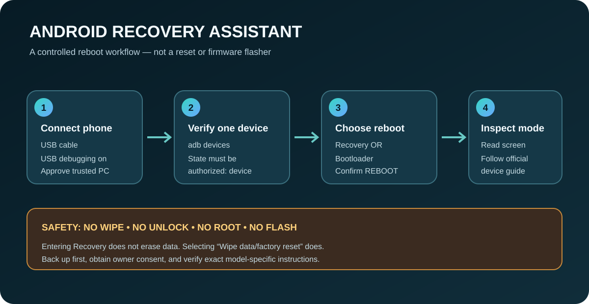
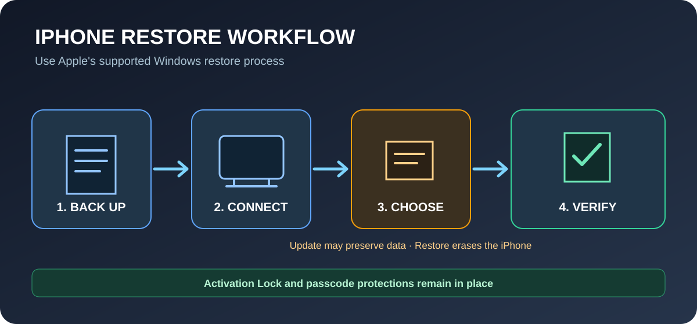
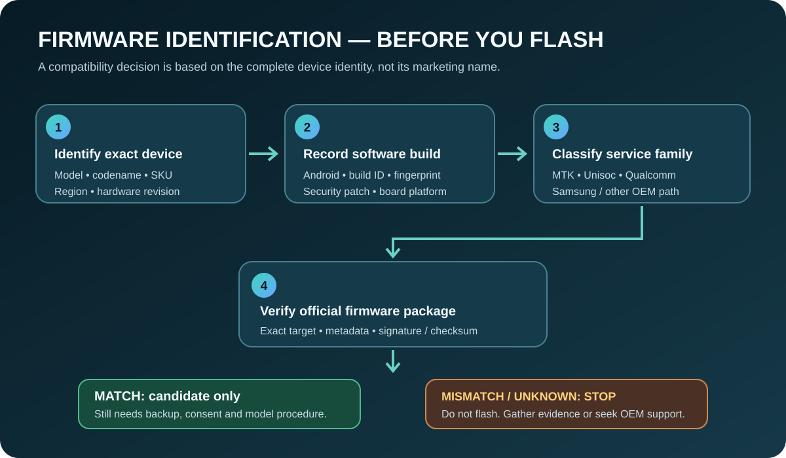
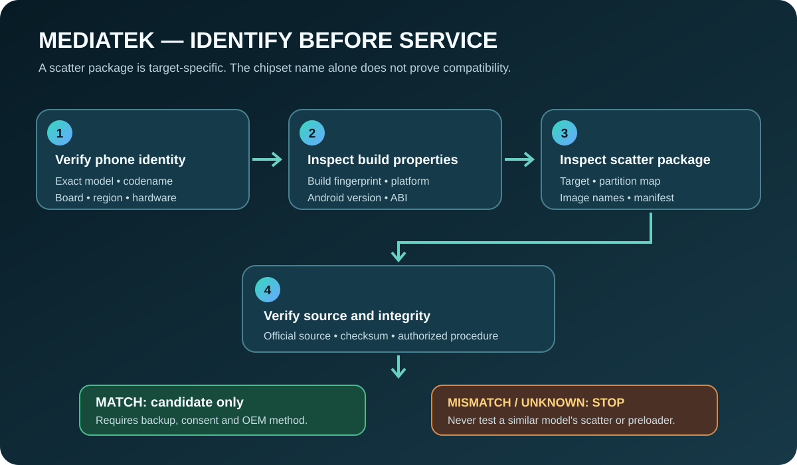
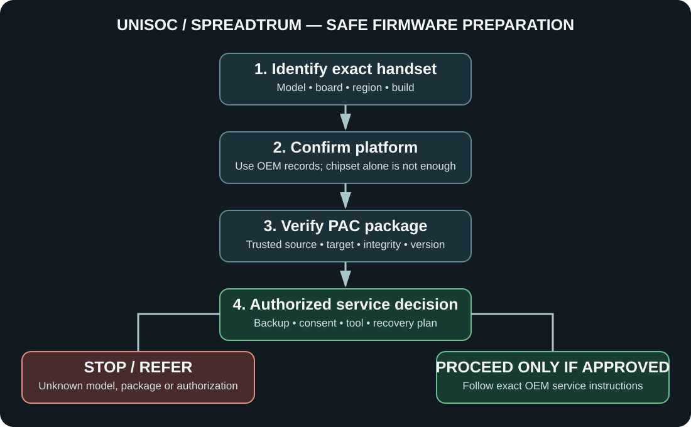

# Flash Tools — Mobile Phone Servicing Training

A practical, command-led learning repository for servicing **Android phones and Apple iPhones** using legitimate software tools.

**Training approach:** learn the command, understand what it changes, inspect the device, back up data, then perform only model-compatible operations.

> This repository is a learning guide, not a universal one-click flasher. Android procedures differ by manufacturer, chipset, model, firmware build and bootloader state. iPhones use Apple's signed restore process rather than Android-style Fastboot flashing.

## Start here

1. [Training roadmap](docs/00-training-roadmap.md)
2. [Windows workstation setup](docs/01-windows-setup.md)
3. [Lesson 1 — ADB device inspection](docs/02-lesson-01-adb-inspection.md)
4. [Android factory reset and recovery](docs/03-android-reset-and-recovery.md)
5. [Android firmware flashing by chipset](docs/04-android-firmware-flashing.md)
6. [iPhone restore, recovery and DFU](docs/05-iphone-servicing.md)
7. [Tools and official downloads](docs/06-tools-catalog.md)
8. [Safety, backups and troubleshooting](docs/07-safety-and-troubleshooting.md)
9. [Device Inspector — first Windows utility](docs/08-device-inspector-tool.md)
10. [Android vs iPhone workflows](docs/09-iphone-vs-android-workflows.md)
11. [Android Recovery Assistant — second Windows utility](docs/10-android-recovery-assistant.md)
12. [Android firmware identification](docs/11-android-firmware-identification.md)
13. [Chipset and manufacturer service families](docs/12-chipset-service-families.md)
14. [MediaTek servicing](docs/13-mediatek-servicing.md)
15. [Unisoc / Spreadtrum servicing](docs/14-unisoc-servicing.md)
16. [M-KOPA phones — authorized servicing and firmware guide](docs/15-mkopa-phone-servicing.md)
17. [Official tool download directory](docs/16-tool-download-directory.md)
18. [Android command reference](docs/17-command-reference.md)
19. [Samsung Galaxy servicing](docs/18-samsung-servicing.md)
20. [Xiaomi / Redmi / POCO servicing](docs/19-xiaomi-servicing.md)
21. [TECNO / Infinix / itel servicing](docs/20-tecno-infinix-itel-servicing.md)
22. [Google Pixel and Motorola / Lenovo servicing](docs/21-pixel-motorola-servicing.md)
23. [iPhone servicing toolkit](docs/22-iphone-servicing-toolkit.md)
24. [USB drivers and troubleshooting](docs/23-drivers-and-troubleshooting.md)
25. [Firmware package audit utility](docs/24-firmware-package-audit.md)
26. [Technician service job record](docs/25-service-job-record.md)

## Visual learning guides

### Android device inspection

### Android operating modes

### Safe Android recovery workflow

### iPhone restoration

### Firmware identification

### MediaTek firmware preparation

### Unisoc firmware preparation

## First coding tool

The read-only Windows PowerShell inspector is at [`tools/windows/flash-tools-inspector.ps1`](tools/windows/flash-tools-inspector.ps1). See the [run instructions](docs/08-device-inspector-tool.md). It detects an authorized ADB device, reads basic properties and saves a local TXT/JSON report. It does not reset, unlock, root or flash.

The [Android Recovery Assistant](tools/windows/android-recovery-assistant.ps1) is the second utility. It can request a reboot to Recovery or Bootloader after explicit confirmation. It does not wipe, unlock or flash.

The [Firmware Package Audit](tools/windows/firmware-package-audit.ps1) is a read-only utility that calculates SHA-256 and lists ZIP contents. It does not extract or flash firmware. See [Lesson 24](docs/24-firmware-package-audit.md).

## Supported learning areas

### Android
- ADB and Fastboot fundamentals
- Read-only device and firmware inspection
- Recovery-mode factory reset
- Official stock firmware identification and restoration
- Model, codename, build fingerprint, region and package verification
- Samsung Odin / Download Mode concepts
- MediaTek scatter package identification and SP Flash Tool concepts
- Unisoc Research Download / Upgrade Download concepts
- M-KOPA handset identification and authorized service pathways (OEM/chipset-specific; no payment-lock bypass)
- Qualcomm EDL / QFIL concepts
- Partition maps, boot images and firmware package formats

### iPhone
- Apple Devices for Windows
- Backup, update and restore workflows
- Recovery mode and DFU mode
- IPSW firmware concepts
- Restore errors and diagnostics

## First device for practice

The initial Android practice device is the learner's **itel A60s (reported model A662LM)**. Always verify the exact model and build from the connected device before selecting firmware. Do not assume firmware for a similar-looking model is compatible.

## Important limits
- No FRP, Activation Lock, passcode, MDM, carrier-lock or account-security bypass instructions.
- No IMEI alteration, identity spoofing, or unauthorized access.
- Do not flash firmware unless the exact model/variant and package have been verified.
- Factory reset and restore operations erase user data. Back up first and obtain the owner's permission.
- Some devices do not expose Fastboot or permit bootloader unlocking.
- iPhone restore is performed through Apple's supported software and signed firmware flow; a generic ADB/Fastboot command cannot flash iOS.

## Official starting points
- Android SDK Platform-Tools: https://developer.android.com/tools/releases/platform-tools
- Google Pixel Android Flash Tool: https://flash.android.com/
- Google Pixel factory images: https://developers.google.com/android/images
- Samsung Smart Switch: https://www.samsung.com/africa_en/support/smart-switch/
- Motorola Rescue and Smart Assistant: https://www.motorola.in/rescue-and-smart-assistant/p
- Carlcare (TECNO / Infinix / itel support): https://www.carlcare.com/
- Android Debug Bridge: https://developer.android.com/tools/adb
- Android device USB setup: https://developer.android.com/studio/run/device
- Apple Devices for Windows: https://support.apple.com/guide/devices-windows/welcome/windows
- Apple iPhone restore guidance: https://support.apple.com/118107

## Progress
- [ ] Windows tools installed
- [ ] Lesson 1: ADB connection and read-only inspection
- [ ] Android reset and recovery (learn menu navigation without wiping)
- [ ] Firmware identification and chipset families
- [ ] First supervised stock firmware restoration
- [ ] iPhone backup and restore workflow
- [ ] iPhone recovery and DFU practice

**Maintainer:** Vince / Flash Tools learning project
