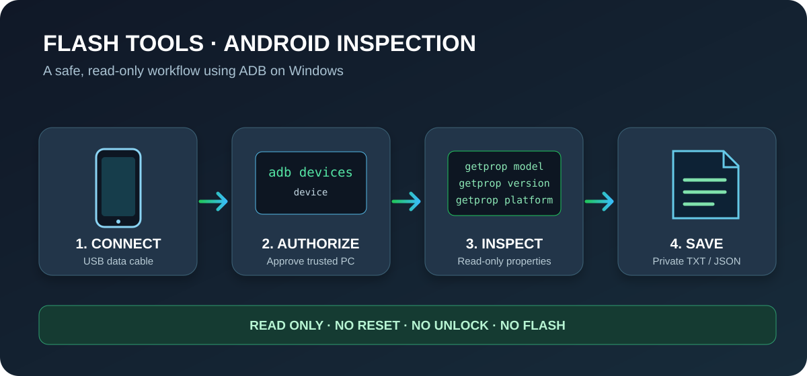

# Tool 1 — FLASH TOOLS Device Inspector

This PowerShell helper collects basic Android device properties through ADB and saves a JSON and TXT report on the Windows computer.



## What it does
- Checks that ADB is installed.
- Lists connected, authorized Android devices.
- Reads manufacturer, model, product, Android version, build, chipset platform and ABI properties.
- Redacts the device serial in the saved report.
- Writes timestamped reports under a local `reports` folder.

## What it does not do
- It does not factory reset or erase user data.
- It does not unlock a bootloader, root, flash, format or write partitions.
- It does not bypass FRP, passcodes or account protections.
- It does not collect IMEI or account credentials.

## Requirements
- Windows 10/11.
- PowerShell 5.1 or newer.
- Google Android SDK Platform-Tools.
- Android phone you own or are authorized to inspect.
- USB data cable and approved USB debugging connection.

## Run it

Open PowerShell in the repository folder:

```powershell
Set-ExecutionPolicy -Scope Process -ExecutionPolicy Bypass
.\tools\windows\flash-tools-inspector.ps1
```

If ADB is not in PATH, provide its full path:

```powershell
.\tools\windows\flash-tools-inspector.ps1 -AdbPath "C:\Android\platform-tools\adb.exe"
```

If your device is shown as `unauthorized`, unlock it and approve the RSA prompt on the phone. Do not approve debugging on a public or untrusted computer.

## Output
Reports are saved in `.
eports`. Keep them private. Before sharing, remove identifying device details and any customer information.

## Exercise
1. Connect one Android phone.
2. Run `adb devices`.
3. Run the inspector.
4. Open the generated TXT report.
5. Compare its model, Android release and board platform with the corresponding manual commands in Lesson 1.
6. Share only the non-sensitive values and any error message with your instructor.
