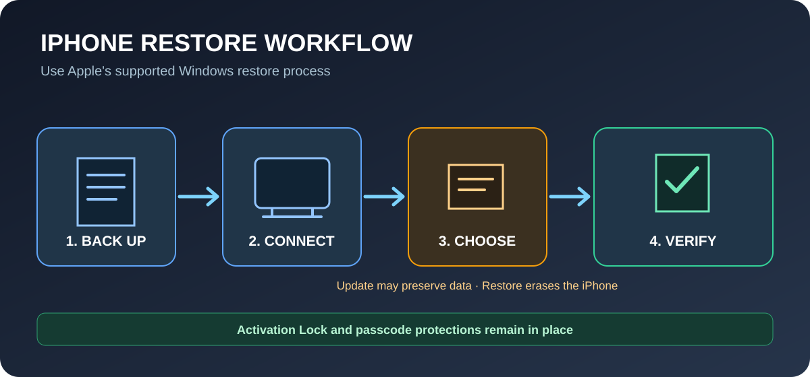
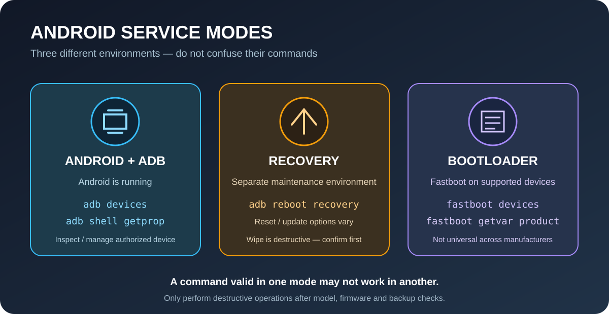

# Android vs iPhone — Which Workflow Applies?

| Task | Android | iPhone |
|---|---|---|
| Inspect while OS runs | ADB, where enabled | Apple Devices / supported diagnostics |
| Reboot to maintenance mode | Recovery or vendor download mode | Recovery mode |
| Low-level restore mode | Depends on chipset/vendor | DFU mode on supported models |
| Factory reset | Settings or stock recovery | Erase All Content and Settings |
| Reinstall OS | Manufacturer/chipset-specific firmware process | Apple Devices restore with signed iOS |
| Firmware package | Vendor-specific formats | IPSW |

## Key lesson
Do not transfer commands between ecosystems. ADB and Fastboot are Android tools; iPhone restore uses Apple's device services and signed firmware flow.
