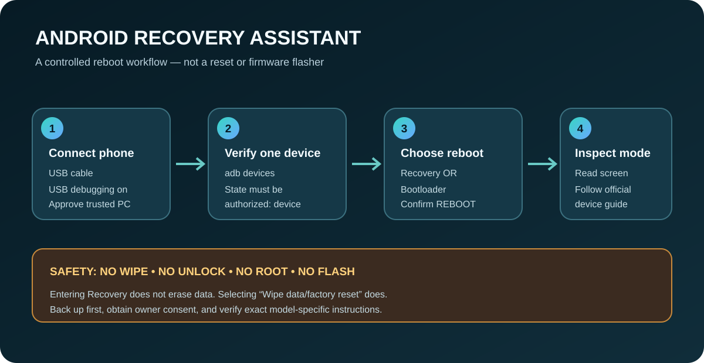

# Tool 2 — Android Recovery Assistant

This Windows PowerShell menu provides two controlled reboot requests through ADB: Android Recovery and Bootloader/Fastboot. It is a learning aid, not a reset or flashing utility.



## Safety boundary

**The tool does not perform a factory reset.** It never runs `adb shell recovery --wipe_data`, `fastboot -w`, `fastboot flashing unlock`, or any partition-writing command. Recovery and bootloader menus can contain destructive options; do not select them without owner authorization, a verified backup and exact device-specific instructions.

## Requirements

- Windows 10/11 and PowerShell 5.1+.
- Google Android SDK Platform-Tools (ADB).
- USB debugging enabled on a device you own or are authorized to service.
- The phone must be booted into Android and show as `device` in `adb devices`.

## Run

From the repository root:

```powershell
Set-ExecutionPolicy -Scope Process -ExecutionPolicy Bypass
.\tools\windows\android-recovery-assistant.ps1
```

If ADB is not in PATH:

```powershell
.\tools\windows\android-recovery-assistant.ps1 -AdbPath "C:\Android\platform-tools\adb.exe"
```

The assistant deliberately stops if more than one authorized device is connected. Disconnect other phones and retry so the command cannot target the wrong device.

## Menu actions

| Choice | ADB command | Effect |
|---|---|---|
| 1 | `adb -s SERIAL reboot recovery` | Requests a reboot to Recovery; does not wipe data |
| 2 | `adb -s SERIAL reboot bootloader` | Requests a reboot to Bootloader; does not unlock it |
| 3 | `adb devices` | Lists ADB connection state |
| 0 | — | Exits without sending a command |

The script requires you to type `REBOOT` before either reboot request.

## Recovery vs factory reset

Entering Recovery is not the same as choosing **Wipe data/factory reset**. A reset is destructive and may trigger Google Factory Reset Protection during setup. The owner must know the Google account previously synced to the phone and complete account verification themselves. This training does not bypass FRP.

## Practice exercise

1. Use a test phone with its owner's permission.
2. Back up important data before exploring recovery menus.
3. Run `adb devices` and confirm exactly one device is listed as `device`.
4. Choose option 1 and observe the Recovery screen without selecting any wipe option.
5. Restart normally using the manufacturer's documented method.
6. Repeat with option 2 only if the manufacturer supports bootloader mode.
7. Record the model, Android version and what modes are available.

## Troubleshooting

- **No authorized device:** check the cable, USB mode, USB debugging and RSA authorization.
- **Unauthorized:** unlock the phone and approve the computer's RSA prompt only if trusted.
- **Offline:** reconnect USB and restart ADB with `adb kill-server` then `adb start-server`.
- **Recovery does not appear:** some manufacturers restrict or implement reboot targets differently. Use the official model-specific key combination or support documentation; do not guess.
- **Fastboot is unavailable:** not every Android device exposes standard Fastboot.

