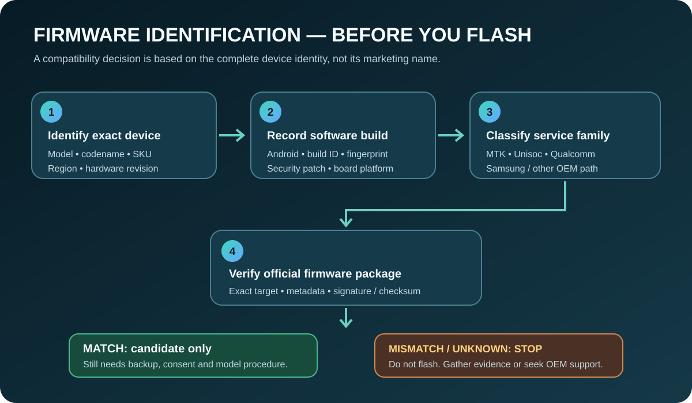

# Module 3 — Android Firmware Identification

Firmware identification happens **before** downloading or flashing a package. The goal is to establish exactly which hardware and software build is on the bench phone, then find a manufacturer-supported package for that exact target.



## 1. Record the complete device identity

Collect these fields from Settings > About phone and, when available, the read-only Device Inspector report:

| Field | Why it matters |
|---|---|
| Manufacturer and brand | Identifies the OEM |
| Exact model number | Separates hardware variants sold under similar names |
| Product / device codename | Often used in firmware package names and compatibility checks |
| Hardware revision / SKU | Can distinguish board, radio or regional variants |
| Android version and SDK | Identifies the platform generation |
| Build number and build fingerprint | Identifies the currently installed software build |
| Security patch level | Helps identify the installed release |
| Region / carrier / CSC | May determine radio, language and customization package |
| Chipset / board platform | Helps identify the relevant service ecosystem |

The Android build fingerprint combines identifying build properties; Android's compatibility documentation defines its structure. See the official [Android Compatibility Definition](https://source.android.com/docs/compatibility/14/android-14-cdd). [Android OTA documentation](https://source.android.com/docs/core/ota/tools) also explains that device names and build fingerprints are used as package preconditions.

## 2. Read-only ADB collection

With USB debugging authorized on a phone you own or are permitted to service, run these from Windows after installing Platform-Tools:

```bat
adb devices
adb shell getprop ro.product.manufacturer
adb shell getprop ro.product.brand
adb shell getprop ro.product.model
adb shell getprop ro.product.name
adb shell getprop ro.product.device
adb shell getprop ro.build.version.release
adb shell getprop ro.build.version.sdk
adb shell getprop ro.build.display.id
adb shell getprop ro.build.fingerprint
adb shell getprop ro.build.version.security_patch
adb shell getprop ro.board.platform
adb shell getprop ro.product.cpu.abi
```

These are inspection commands. They do not change partitions or erase user data. Some properties may be blank, vendor-specific or report different values across product/system/vendor partitions. Record the output exactly; do not guess missing values.

## 3. Verify the identity from more than one place

Compare:
- Settings > About phone.
- Device Inspector output.
- Manufacturer support page or official firmware page.
- Package metadata and release notes.

If the model suffix, codename, region or build does not match, stop. A shared marketing name is not enough to establish compatibility.

## 4. Identify the chipset family — but do not infer firmware from chipset alone

| Family | Common clues / ecosystem | What must still be verified |
|---|---|---|
| MediaTek (MTK) | Board/platform property may contain an MTK identifier; scatter packages are common in some service workflows | Exact board, memory layout, preloader and signed/authenticated service requirements |
| Unisoc | May appear as Spreadtrum/Unisoc platform identifiers; PAC packages are common in some workflows | Exact board revision and package target |
| Qualcomm | Platform properties may contain Qualcomm/SM identifiers; EDL is supported only on some devices | Exact product, programmer authorization/signature and OEM procedure |
| Samsung | Manufacturer-specific model and CSC/region identifiers; Download Mode/Odin ecosystem | Exact model code, binary revision and CSC/region |
| Google Pixel | Google device codename and official factory image/update channel | Exact codename, build and Google's current installation instructions |

The chipset is only one part of compatibility. Two phones with the same chipset can have different storage layouts, displays, radios, bootloaders and signed firmware.

## 5. Firmware package verification

Before treating a package as a candidate, check:

1. The source is the manufacturer or an explicitly authorized service source.
2. The full model code and hardware variant match.
3. The region, carrier or CSC matches where applicable.
4. The package version and anti-rollback level are appropriate.
5. The package's own metadata identifies the expected product/device and build.
6. The published checksum or signature verifies, if supplied.
7. The package is complete and not a modified/repacked copy.
8. The official procedure and recovery path are available.

Android incremental OTA packages are tied to a specific source build; Google's documentation warns that an incremental package must be applied to the exact source build it was created for. Prefer the full official update path if the exact source build cannot be established. Read [AOSP OTA tools](https://source.android.com/docs/core/ota/tools).

## 6. Stop conditions

Do not flash if:
- The exact model or codename is unknown.
- The package is for a similar model but not the exact variant.
- The region/CSC or hardware revision conflicts.
- The package source is a random file host or modified archive.
- A checksum fails or no trustworthy package verification is available.
- Anti-rollback requirements are unclear.
- The phone's storage or board may be failing.
- There is no backup, owner consent or recovery plan.

## 7. Practice worksheet

Use this worksheet for your own test phone. Do not publish serial numbers, IMEI, phone numbers, account details or customer data.

| Field | Your observation |
|---|---|
| Manufacturer | |
| Exact model code | |
| Product / codename | |
| Android version / SDK | |
| Build number | |
| Build fingerprint | |
| Security patch | |
| Board platform / chipset | |
| Region / CSC / SKU | |
| Source of firmware candidate | |
| Exact package target | |
| Checksum / signature result | |
| Decision | STOP / NEED MORE INFO / VERIFIED CANDIDATE |

**Important:** “Verified candidate” means the package appears to match the recorded target; it is not permission to flash. A separate model-specific procedure and explicit owner approval are still required.
