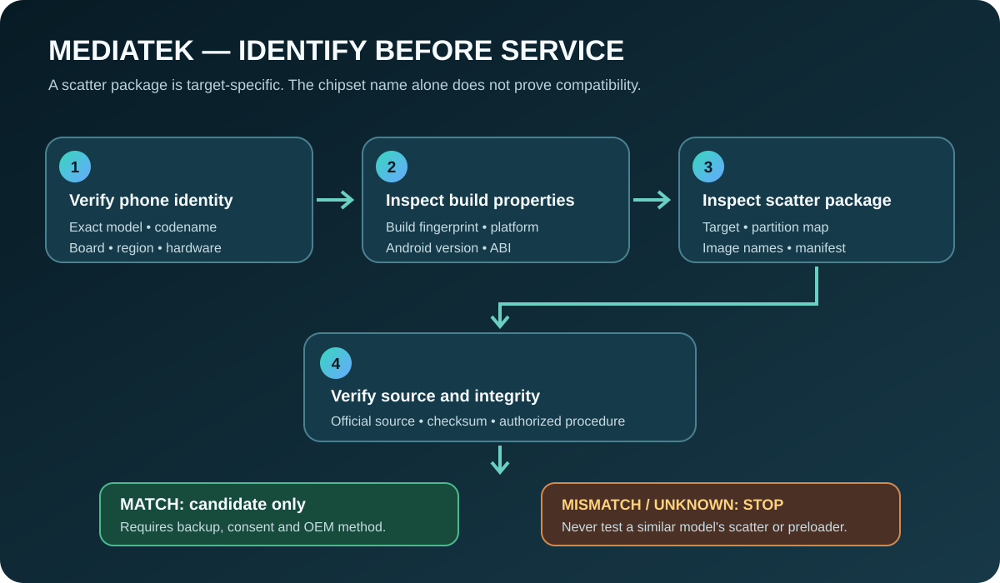

# Module 5 — MediaTek (MTK) Android Servicing

MediaTek is a chipset family used in many Android phones. Some MTK service firmware packages use a **scatter file** to describe the device's partition layout. A scatter file is not universal: it belongs to a specific target and firmware release.



## 1. Identify the device first

Record the complete identity before looking for firmware:

- Manufacturer and full model code (including suffixes).
- Product/device codename and hardware revision, if available.
- Android version, build number and build fingerprint.
- Board platform / chipset property.
- Region, SKU or carrier variant.
- Current bootloader/service mode, if officially documented.

A chipset name alone is not enough. Two phones using a related MediaTek platform may have different storage sizes, partition maps, display panels, radios, secure-boot configuration and firmware.

## 2. Read-only platform inspection

On an authorized Android device with USB debugging enabled, these ADB commands read build properties:

```bat
adb devices
adb shell getprop ro.product.manufacturer
adb shell getprop ro.product.model
adb shell getprop ro.product.device
adb shell getprop ro.build.fingerprint
adb shell getprop ro.board.platform
adb shell getprop ro.hardware
adb shell getprop ro.product.cpu.abi
```

Property names and values vary by OEM. A blank or generic result does not prove a chipset. Cross-check with the manufacturer's specifications, service documentation and exact model identifier.

## 3. What is a scatter file?

A scatter file is a text-based description used by some MediaTek firmware/service packages. Depending on the package generation, it can describe:
- Platform / target identifier.
- Storage type and layout assumptions.
- Partition names.
- Partition start addresses and sizes.
- Firmware image filenames associated with partitions.

It is **not** a generic partition map for all MediaTek devices. Never edit a scatter file or load one from a similar model as an experiment.

## 4. Recognize common package contents

A vendor package may include some of the following. Names and structure vary:

| Item | General purpose | Technician caution |
|---|---|---|
| Scatter description | Describes a target partition layout | Must match the exact target |
| Boot image | Boot-related kernel/ramdisk components | Must match the device build and verified-boot scheme |
| Recovery image | Recovery environment | Not interchangeable across models |
| System / vendor images | Android OS components | May be delivered as sparse, raw or dynamic-partition images |
| Preloader-related component | Early platform initialization on some devices | Wrong or incompatible preloader can make recovery difficult |
| Download Agent (DA) | Helps supported service tools communicate with storage | May require OEM authorization or device-specific authentication |
| Checksum / manifest | Package integrity or file listing | Verify against a trusted source |

Do not assume every package contains every item. Do not write preloader, bootloader, NVRAM/NVDATA or other partitions as a test.

## 5. Understand the service-tool ecosystem

Some MediaTek service workflows use SP Flash Tool or manufacturer-authorized utilities. Tool versions, supported chipsets, authentication requirements and device states vary.

Before using any service utility, establish:
1. The utility is obtained from an official or trusted authorized source.
2. The exact phone model and board are supported.
3. The package is intended for that exact target.
4. The service method is documented by the OEM or authorized provider.
5. The package integrity is verified.
6. Backup, data-loss consent and a recovery plan are in place.

This lesson does not provide authentication bypass, security bypass, or instructions to defeat device protections.

## 6. Package verification worksheet

| Check | Result |
|---|---|
| Exact manufacturer/model | |
| Device codename / board | |
| Hardware revision / SKU | |
| Region / carrier | |
| Current build fingerprint | |
| Chipset confirmed by reliable source | |
| Firmware source | |
| Firmware package target | |
| Scatter target/platform matches | |
| Package checksum/signature verified | |
| OEM procedure available | |
| Backup and owner consent confirmed | |
| Decision | STOP / NEED MORE INFO / VERIFIED CANDIDATE |

## 7. Stop conditions

Stop and do not flash when:
- The model code or board identifier is uncertain.
- The scatter target/platform differs from the phone.
- The package came from an unknown mirror or modified archive.
- A required DA/authentication component is missing or its legitimacy is uncertain.
- The procedure asks you to format or erase partitions without a documented, authorized reason.
- The package contains an unexplained preloader or partition map.
- You have no backup, owner consent or recovery route.

## 8. Knowledge check

1. Does the same MediaTek chipset guarantee the same firmware? **No.**
2. What does a scatter file describe? **A target-specific partition layout and related package information.**
3. Should a preloader from a similar model be tested? **No.**
4. Does identifying an MTK chipset prove that SP Flash Tool supports the phone? **No.**
5. What should happen when the package target does not match? **Stop and verify; do not flash.**

## Next lesson

The next module covers Unisoc/Spreadtrum devices and PAC packages. The same rule applies: identify the exact target and follow an official, authorized procedure.
