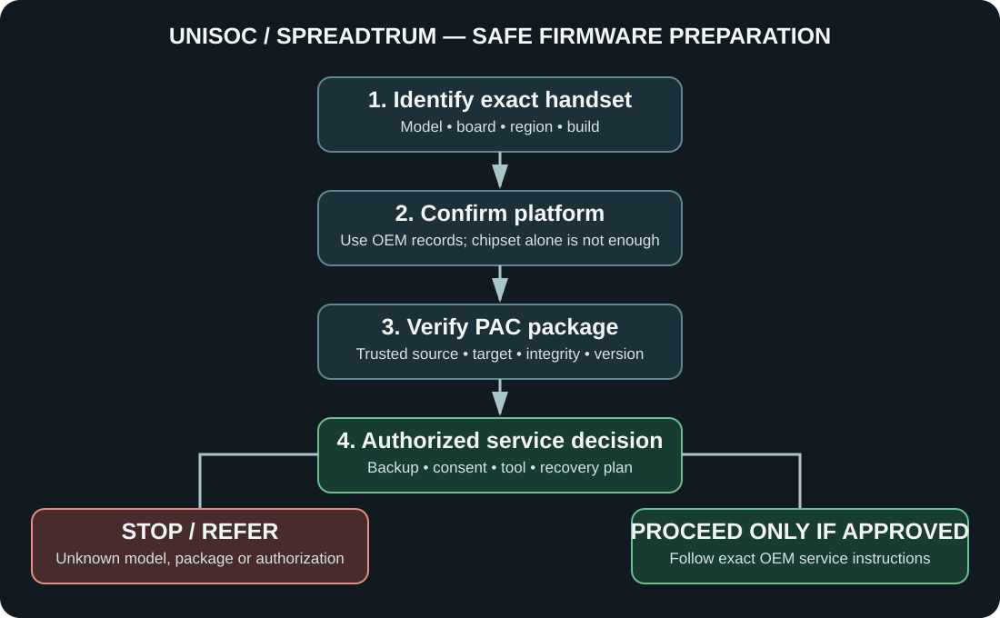

# Lesson 28 — Unisoc PAC Firmware Fundamentals (itel A60s A662LM)

## Learning objectives
- Explain what a PAC firmware package is used for in Unisoc servicing.
- Distinguish device identification from firmware compatibility proof.
- Recognize Research Download / Upgrade Download at a high level.
- Perform safe, read-only firmware research and package auditing.
- Identify conditions that mean a package must not be installed.

**Practice device:** itel A60s, A662LM, reported Unisoc SC9863A, Android 12.

## 1. What is a PAC file?

A `.pac` file is a firmware package format used in a range of Unisoc / Spreadtrum service workflows. A service package may contain multiple device software images and configuration metadata. A compatible service application may parse the package and determine which components apply to a target device.

A PAC extension alone does not prove that a package is authentic, belongs to the exact hardware or regional variant, meets security/anti-rollback requirements, is complete, or is supported by a particular tool release. Do not rename another file to `.pac`, combine components from different releases, or assume all Unisoc devices use the same package layout.

## 2. Service-tool terminology

| Term | High-level role |
|---|---|
| Research Download | Unisoc/Spreadtrum service application used by technicians for supported firmware operations |
| Upgrade Download | Related Unisoc service workflow/tool name used for supported upgrade packages |
| PAC | Firmware package container consumed by compatible service tools |
| FDL / download loader | Download-stage components used by certain Unisoc service flows |
| USB download/diagnostic interface | Device connection mode exposed for authorized servicing |

Tool versions, package support, loader requirements and device access restrictions vary. Some tools and packages are distributed only to authorized service centers. Use vendor-authorized software and documentation for actual restoration.

## 3. Your device identity checkpoint

| Field | Confirmed/reported value |
|---|---|
| Model | A662LM |
| Product family | itel A60s |
| Build | `A662LM-SR370ABCDEFGIJ-SGo-GL-250401V596` |
| Android | 12 |
| Security patch | 2025-03-05 |
| Reported chipset | Unisoc SC9863A |
| Baseband identifier | `sc9863A_modem` |

The middle build sequence is **ABCDEFGIJ** (without H). This corrected value supersedes the earlier transcription in the device profile.

A third-party firmware index displays the same A662LM build pattern. This is useful corroboration only, not an official itel download confirmation or proof that a package is safe.

## 4. Safe PAC workflow



1. Identify the phone from Settings and, when available, read-only ADB properties.
2. Record model, product/device identifiers, region, build fingerprint, Android version and security patch.
3. Obtain a package only through itel/Carlcare or another source explicitly authorized by the manufacturer for that exact model.
4. Verify the package's published hash/signature where the publisher provides one.
5. Use the repository's read-only Firmware Package Audit utility to calculate SHA-256 and list archive entry names.
6. Have an authorized technician confirm package compatibility, service-tool version, loader requirements and data-loss implications.
7. Treat actual restoration as a separate, authorized repair operation. This lesson does not flash anything.

## 5. Practical exercise A — phone-only

No computer or extra app is required.

1. Open **Settings → My Phone / About Phone**.
2. Confirm the model says **A662LM**.
3. Confirm the build string contains **ABCDEFGIJ**.
4. Confirm Android version is **12**.
5. Compare the values with [your device profile](27-device-profile-itel-a60s-vince.md).

Do not enter bootloader, diagnostic or download mode for this exercise.

## 6. Practical exercise B — Windows PC, read-only

When a Windows PC is available, install Android Platform-Tools, connect the phone and authorize USB debugging. Run:

```powershell
adb devices -l
adb shell getprop ro.product.model
adb shell getprop ro.product.device
adb shell getprop ro.product.name
adb shell getprop ro.build.display.id
adb shell getprop ro.build.fingerprint
adb shell getprop ro.board.platform
adb shell getprop ro.boot.hardware
adb shell getprop gsm.version.baseband
adb shell getprop ro.build.version.security_patch
```

These commands read properties; they do not flash or erase data. If a property is blank, do not guess its value. Save output privately and redact unique identifiers.

## 7. Practical exercise C — package audit, not installation

Only use a firmware archive from a source you are authorized to use. Do not download a random mirror just to practise.

The repository utility calculates SHA-256 and lists ZIP archive contents:

```powershell
.\tools\windows\firmware-package-audit.ps1 -PackagePath "C:\Firmware\authorized-package.zip"
```

If the publisher supplies a trusted SHA-256 value, compare it:

```powershell
.\tools\windows\firmware-package-audit.ps1 -PackagePath "C:\Firmware\authorized-package.zip" -ExpectedSha256 "PUBLISHER_SHA256"
```

The utility is read-only. It does not extract, modify, authenticate a vendor signature, or flash firmware. A hash without a trusted reference hash only identifies the file; it does not prove that the file is genuine.

## 8. Stop conditions

Do not proceed to installation if the model or regional variant is uncertain; the build difference is unexplained; package provenance is unknown; the hash differs from the publisher's value; the archive is damaged; the tool requests an unknown loader or authorization; or there is no verified backup and owner consent for data loss.

Never experiment with erase, format, repartition, NV/provisioning, identity, or individual partition-write operations. Do not use service tools to bypass account protection or alter device identity.

## 9. Knowledge check

1. What does the PAC extension tell you—and what does it not prove?
2. What is the exact model identifier of your practice phone?
3. What is the exact build string, including the middle sequence?
4. Does a matching model and build filename alone prove a package is safe?
5. What does a SHA-256 hash tell you if you do not have a trusted publisher hash to compare?

## References
- itel A60s official product information: https://www.itel-life.com/products/phone/a-series/a60s
- Carlcare official support: https://www.carlcare.com/
- A662LM firmware build listing (third-party; corroboration only, not an endorsed download source): https://www.hovatek.com/forum/thread-49816.html
- A662LM / SC9863A device information (third-party reference): https://www.deviceinfo.app/devices/itel/a60s/
- Android Platform-Tools: https://developer.android.com/tools/releases/platform-tools

**Lesson rule:** identify first, verify provenance second, audit third. Flashing is a separate, model-specific, authorized repair operation—not a practice exercise.
